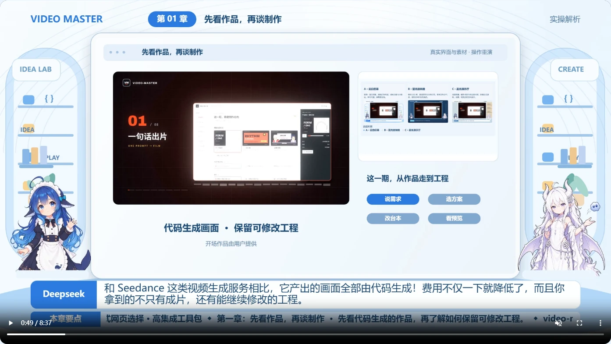
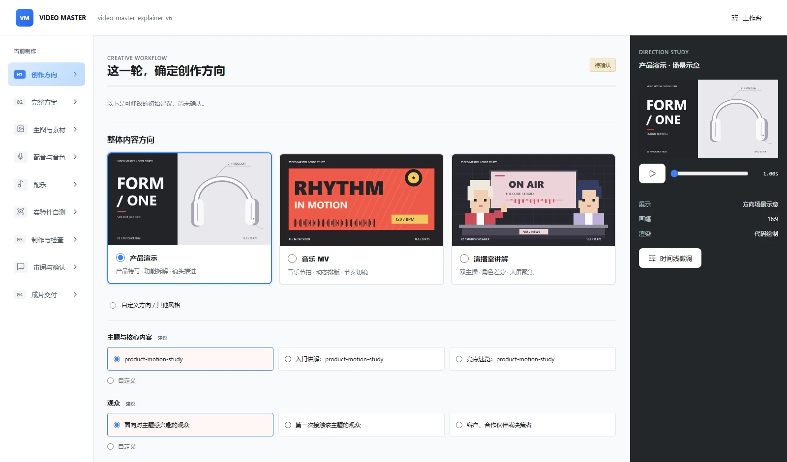
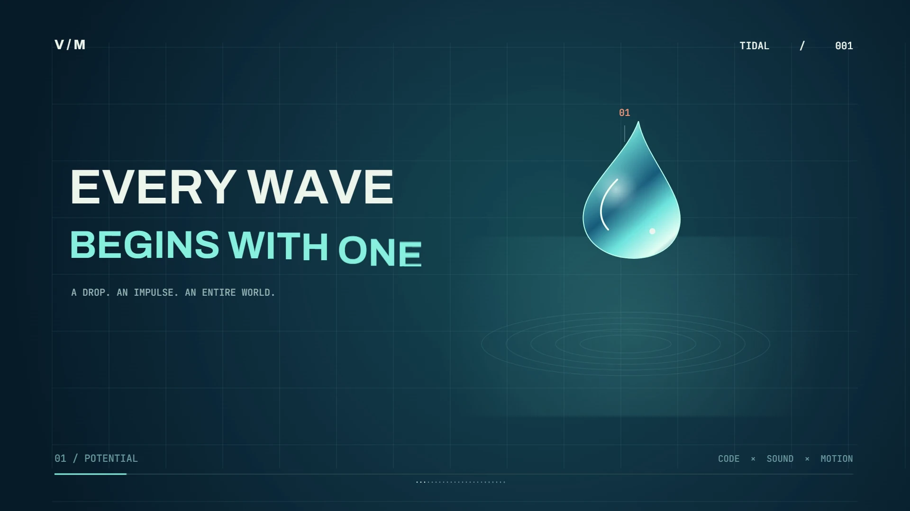

# v0.3.0 更新说明

- **新增可选 Multiplane 渲染后端**：支持浏览器场景的并行捕获、硬切边界感知运动模糊，以及已完成分段的断点恢复。
- **延续现有制作能力**：保留 Motionkit、网页工作台和演播室逻辑；新后端复用多轨音量、对白压低及平滑恢复策略。
- **增加初始化与检查工具**：独立工程初始化、编码器实测、确定性检查、完整解码检查与 SHA-256 交付回执。
- **补充实际验证片**：原创 10 秒 MV《TIDAL》，1920×1080、30fps，含代码动画、配乐和转场。
- **使用边界**：可选后端要求 Node.js 24+；首版支持同步场景绘制，异步视频 seek 沿用原渲染路径。GPU 绘图与硬件编码分开配置，不承诺固定提速比例。

下载：[v0.3.0 Skill 安装包](https://github.com/Tikzen/video-master/releases/tag/v0.3.0)。详细用法见下方说明与 [`references/renderers/multiplane.md`](references/renderers/multiplane.md)。

---

# 武汉1024黑客松参赛作品

## Video Master · v0.3.0

**让代码承担制作，把创意留给你。**

Video Master 是一个面向编码智能体的 **视频制作 Skill**。你描述主题、提供素材、选择风格，它引导智能体完成方案、台本、分镜、代码动画、配音配乐、预览修改和成片导出，最终交付 **MP4 + 可继续编辑的源工程**。

核心思路很简单：**由智能体编写代码来生成画面、组织镜头和控制时间线，把视频制作变成可以精确修改、重复渲染的工程。**

项目仓库：[Tikzen/video-master](https://github.com/Tikzen/video-master)

> 当前版本：**v0.3.0**，新增可选的 Multiplane 渲染后端。项目持续开发中。它需要一个能够读写文件、执行命令和编写代码的智能体，以及本地运行环境；单独把 Skill 发给一个只能文字聊天的模型，无法完成视频制作。



*实际项目成片截图：双主持人、大屏讲解、界面素材与字幕组合呈现。下方配图均来自本地网页实拍；演播室和角色是本次项目的定制效果，不是安装后固定出现的模板。*

## 项目亮点

### 1. 代码生成画面，制作成本更可控

主要画面由代码绘制、排版和动画编排，不需要为每一段画面调用文生视频服务。文字、图形、网页截图、图表、角色图片和已有视频都可以成为画面素材。

需要改字幕、镜头、配色或音量时，可以修改对应代码与参数，先验证受影响的片段，再导出成片。编码智能体、云端配音和生图可能产生费用，本地渲染也消耗算力；**低成本是制作方式的目标，不代表所有环节免费。**

### 2. 从需求一直做到成片

不止生成一份台本或分镜表。工作流覆盖需求确认、创意方案、素材准备、动画实现、声音制作、预览修改、编码导出和成片检查，并保留源工程，方便后续更新。

### 3. 网页做选择，智能体负责执行

默认通过本地网页展示方案、素材选项和预览。你选择方向、提交意见，智能体读取结果后继续制作，不必把每个参数都写成一长串提示词。

网页是确认和预览界面，制作仍由当前智能体会话执行；提交反馈时请保持智能体会话可继续运行。



*网页工作台截图：选择产品演示、音乐 MV 或演播室等方向，并查看场景示意；图中为方向选择页的实际初始选项。*

### 4. 同一套工作流，支持多种视频

| 类型 | 可以制作的内容 |
| --- | --- |
| 音乐短片 / MV | 图形动画、动态文字、节奏编排与镜头转场 |
| 产品介绍 | 界面截图、模拟点击、功能讲解与案例展示 |
| 产品报告 | 数据图表、信息层级、结论呈现与章节叙事 |
| 双主持人演播室 | 角色差分、说话微动作、大屏演示、对话与字幕 |
| 可复用节目包 | 品牌视觉、动作语言、场景系统和演播室包装 |

示例工程用于提供实现参考。风格、布局、镜头和转场可以按需求重新设计，并非只能替换模板里的文字。

### 5. 角色、画面和声音共用时间线

演播室可结合角色表情与动作差分、整图微动作、大屏展示和章节转场。对白间隙保留上一段显示状态，避免人声结束时画面意外跳回默认内容。

人声、背景音乐、音效和插入视频原声分别管理，支持音量调整、淡入淡出和对白期间的背景音乐压低。配音可以使用已有录音、本地语音或配置后的外部服务。


*角色预演页截图：本次项目使用 10 张表情差分和 6 张动作差分，可逐张检查效果；这是配音对齐前的局部预演页面。*

### 6. 先预览，再导出；检查真正的成片

先看实际渲染画面与必要的短片段，集中处理修改意见，确认后再做完整导出。检查包括时长、分辨率、帧率、音视频解码、字幕和转场边界等；预览通过不等于成片已经交付。


*交付页截图：已完成项目的 8 分 37 秒、1080p、30fps MP4，可在网页播放，并保留工程预览入口。截图展示该案例的交付结果，不代表所有视频采用相同长度或版式。*

### 7. 可选 Multiplane 后端：并行捕获、运动模糊与断点恢复

v0.3.0 增加基于 **Multiplane 0.3.13** 的可选渲染路径，适合按绝对时间绘制的 HTML、CSS、SVG、Canvas 和 WebGL 场景。支持多工作进程捕获、避开硬切边界的时间采样运动模糊，以及有已完成分段时的断点恢复。

接入保留原有网页工作台、演播室显示状态、多轨混音和 Motionkit 引擎。新路径共用音量、对白压低与恢复曲线，导出后执行解码检查并生成带 SHA-256 的回执。

GPU 绘图和 GPU 编码分别配置；并行捕获和额外采样的实际收益取决于场景与硬件，**没有统一提速百分比**。首版要求同步绘制，异步视频逐帧 seek 仍使用原有渲染路径。



*本次接入制作的原创 10 秒 MV《TIDAL》：1080p、30fps，代码画面配原创程序化配乐。配图提取自实际编码成片，视频文件不随 Release 分发。*

## 安装

### 方式一：使用 Skill 安装包

1. 下载 [**v0.3.0 Release**](https://github.com/Tikzen/video-master/releases/tag/v0.3.0) 附件中的 `video-master-v0.3.0.zip`。
2. 解压后得到 `video-master` 文件夹，其中应直接包含 `SKILL.md`。
3. 将整个文件夹放到你的智能体支持的 Skill 目录。支持项目级 `.agents/skills` 的环境可使用下面的结构。
4. 按宿主工具的方式重新加载 Skill，然后在对话中明确要求使用 `video-master`。

```text
你的项目/
└─ .agents/
   └─ skills/
      └─ video-master/
         ├─ SKILL.md
         ├─ scripts/
         ├─ workflows/
         └─ ...
```

当前安装包文件名为 `video-master-v0.3.0.zip`。GitHub 自动生成的 Source code 归档用于查看仓库源码；直接安装 Skill 时优先使用上述附件。

如果宿主不自动识别 Skill，可以让智能体直接读取该目录的 `SKILL.md`，然后遵循其中的工作流。

### 方式二：从源码安装

在支持项目级 `.agents/skills` 的环境中，于你的项目目录运行：

```bash
git clone https://github.com/Tikzen/video-master.git .agents/skills/video-master
```

从仓库安装时，确认 `SKILL.md` 位于 `video-master` 目录的第一层。不同宿主的发现路径可能不同，以宿主的 Skill 配置为准。

## 运行环境

| 环境或能力 | 用途 |
| --- | --- |
| 可执行命令、读写文件的编码智能体 | 读取 Skill、设计方案、编写和执行工程代码 |
| Python 3.10+ | 工作流脚本、素材处理和部分动画能力 |
| Node.js 22+，推荐 24；npm | 本地网页工作台与 JavaScript 渲染流程；可选 Multiplane 后端要求 Node.js 24+ |
| Playwright Chromium | 浏览器渲染与画面检查，按需安装 |
| FFmpeg / FFprobe | 音视频处理、编码及文件信息检查 |
| 配音、生图等服务配置 | 按所选制作方案启用，不是所有项目都需要 |

智能体会按工作流检查运行环境，并在视频工程中准备需要的依赖。详细要求见 Skill 内的 `references/portable-runtime.md`。

**Skill 安装目录和视频输出目录要分开。**不要直接在 `assets/starter-project` 中制作正式项目。首次准备运行依赖可能需要下载较大的文件；安装包较小，不意味着运行时只占用同样大小的磁盘空间。

API 密钥使用项目内不提交到仓库的 `.env` 或进程环境变量，具体字段见对应的生图、配音工作流。不要把密钥写进台本、公开配置或成片。

## 快速开始

安装后，直接给智能体一段制作需求即可。建议包含：**主题、观众、时长、风格、已有素材、输出目录和声音要求**。不确定的部分可以让它提出方案。

### 示例一：双主持人产品解析

```text
使用 video-master，制作一支约五分钟的双主持人产品解析视频。
以实际使用方法为主线，展示真实界面截图和模拟点击效果；
代码与实现原理集中放在一个单独章节。

演播室采用蓝白配色和大屏幕，两位角色不要遮挡演示区域。
我会提供角色图片、开场视频和一个成品案例。
背景音乐要有变化，人物说话时压低，停顿后平滑恢复。
章节之间使用独立转场，结尾放项目地址和致谢。

先通过网页让我选择方案，台本写好后等我修改，
预览确认后再导出整片。所有输出放到我指定的项目目录。
```

### 示例二：原创音乐短片

```text
使用 video-master，制作一支15秒的原创音乐短片，主题是水滴。
用代码生成主要动态画面，带配乐和转场，节奏有起伏。
先给我不同的视觉方案选择，再开始制作。
```

### 示例三：修改已有工程

```text
使用 video-master 修改这个已有视频工程。
将第二章大屏里的截图换成新版本，更新对应字幕；
对白期间的背景音乐提高20%，其他画面和配音保持不变。
先检查修改片段，确认后输出一个新版本。
```

只提供 MP4 时，可以把它作为参考素材；要直接延续原有工程的镜头和时间线，请同时提供可编辑的源工程。

## 一次制作如何进行

1. **提出需求**：说明目标、素材和限制，智能体确定适合的制作路线。
2. **网页选方案**：确认风格和方向，再确认具体制作方案。
3. **准备台本与素材**：整理分镜、截图、角色差分、录音或配音需求。需要付费服务时先说明用途。
4. **制作画面与声音**：编写场景、安排镜头、转场、字幕和混音。
5. **预览并修改**：查看真实渲染结果，按镜头或时间点提交意见。
6. **导出与交付**：确认后导出完整 MP4，并保留源工程和检查结果。

如果明确要求“一句话完成”或委托智能体自行决定，可启用快速流程，减少确认轮次；运行环境检查、实际渲染与交付检查仍保留。

## 源码结构

下面是 Skill 解压后的主要目录：

```text
video-master/
├─ SKILL.md                 总入口与制作规则
├─ agents/                  可选的宿主元数据
├─ workflows/               创建、修改及不同视频类型的工作流
├─ references/              创作方法、运行环境、接口与质量检查
├─ scripts/                 初始化、网页工作台、素材和打包工具
├─ engine/                  Motionkit 引擎与可选 Multiplane 适配器
├─ assets/                  工程起点、示例与网页素材
├─ vendor/                  第三方组件、来源说明与许可证
├─ requirements-audio.txt   可选音频处理依赖
└─ requirements-images.txt  图片处理依赖
```

**依赖清单需要保留，已安装的依赖目录不需要发布。**例如，`package.json`、`package-lock.json` 和 `requirements-*.txt` 属于源码分发的一部分；`node_modules/`、缓存、渲染输出与私人配置不属于安装包。

## v0.2.0 发布内容

本次为首个发布版本，包含：

- 创建视频、创建可复用视频包、修改现有工程三条工作流。
- 本地网页方案确认、预览与智能体控制接口。
- 演播室、产品介绍、报告和音乐短片的制作说明与示例。
- 角色差分管理、整图微动作、字幕与时间线相关工具。
- 本地及外部配音工作流、基础程序化配乐和多轨混音支持。
- 渲染、检查与可分发 Skill 打包脚本。

仓库保存便于阅读与修改的源码；Release 附件提供可以解压安装的 Skill ZIP。

## 适用边界

- 更适合代码可控的动态视觉、界面讲解、信息图表和演播室编排，不等同于生成任意实拍镜头的文生视频模型。
- 基础程序化配乐是可选能力；对音乐制作要求较高时，可以提供合适的配乐或使用另行配置的工具。
- 渲染耗时受画面复杂度、时长、分辨率和本机性能影响，不保证实时导出。
- 图片、录音和视频素材的使用范围需自行确认；第三方组件与字体保留各自的来源和许可说明。

## 特别感谢

感谢 **[hugohe3/ppt-master](https://github.com/hugohe3/ppt-master)**，为 Video Master 的工作流组织与交互确认机制提供了项目灵感。部分图片适配组件复用了其实现，对应来源、改动边界和许可证保存在 `vendor/ppt-master/` 与 `references/ppt-master-migration.md`。

同时感谢项目所使用的第三方组件、字体和相关工具的作者。Video Master 是独立项目，并非 PPT Master 的官方发行版。

v0.3.0 的可选浏览器渲染后端接入了 **[LBEILC/Multiplane](https://github.com/LBEILC/Multiplane)**，感谢其提供并行捕获、后期采样与作业恢复能力。上游通过固定版本 npm 依赖按需安装，其许可证与声明随对应依赖分发。
